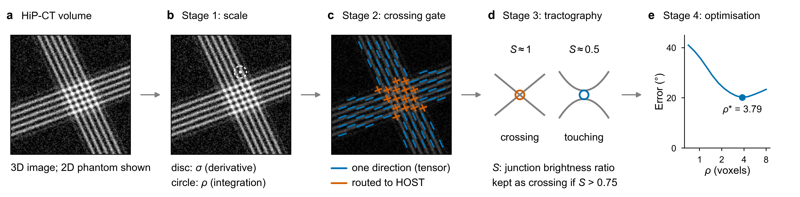
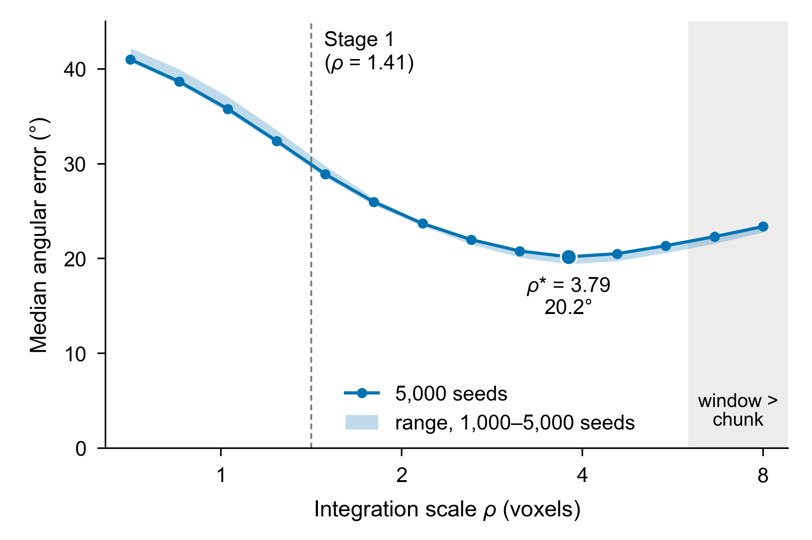

<div align="center">

<h1>Optimising the Structure Tensor Analysis of<br>White Matter Fibres in Synchrotron Tomography</h1>

Isabella Hezhao<sup>1</sup> · Andrew Keenlyside<sup>2</sup>

<sup>1</sup>Department of Medical Physics and Biomedical Engineering, University College London<br>
<sup>2</sup>UCL Hawkes Institute, University College London

[](https://github.com/1ssot0pe/HiP-CT_Structure_Tensor/actions/workflows/ci.yml)
[](LICENSE)
[](https://doi.org/10.5281/zenodo.24289711)

[Pipeline](docs/PIPELINE.md) | [Work log](docs/WORKLOG.md) | [Release](https://github.com/1ssot0pe/HiP-CT_Structure_Tensor/releases) | [Citation](#citation)



</div>

<sub><b>Figure 1.</b> Pipeline overview, drawn on a 2D phantom of two fibre
bundles crossing at 85°. In <b>c</b> the gate decision is computed; at routed
patches the two segments show the phantom's true directions. <b>e</b> is the
measured curve from Figure 2. Script:
<a href="docs/figures/make_pipeline_overview.py"><code>make_pipeline_overview.py</code></a>.</sub>

## Motivation

Along a fibre, image intensity barely changes; across it, intensity changes
sharply. The structure tensor uses this to give one fibre orientation per
voxel. It has two scales: the derivative scale **σ** (how finely gradients are
measured) and the integration scale **ρ** (how widely they are averaged). The
orientation depends on both, and both are usually set by hand. Where two fibres
cross, a single orientation is also simply wrong.

This repository sets σ and ρ from the data, resolves crossings, and tests the
result with tractography. It was written for Hierarchical Phase-Contrast
Tomography (HiP-CT) of human brain white matter.

## Method

1. **Scale selection** ([`1_sigma_rho_selection`](1_sigma_rho_selection/)).
   Choose σ and ρ for each 32³-voxel block from the image itself (Lindeberg
   scale selection).
2. **Crossing gate** ([`2_host_classification`](2_host_classification/)).
   Keep one orientation where a patch is clearly directional. Elsewhere, fit up
   to two with the higher-order structure tensor
   ([HOST](2_host_classification/README.md#how-host-is-used-in-the-pipeline)).
3. **Tractography** ([`3_global_tractography`](3_global_tractography/)).
   Track fibres through the field, test each crossing with a brightness ratio,
   and refine the field.
4. **Optimisation** ([`4_optimising_parameters`](4_optimising_parameters/)).
   Find the single (σ, ρ) whose plain structure tensor best reproduces the
   refined field.

## Result

<p align="center">
  
</p>

<sub><b>Figure 2.</b> Median angular error between the refined field and a plain
structure tensor, against ρ (i74 brain, one 48³-voxel chunk, 20 µm voxels,
σ = 1.00). Line: 5,000 seeds. Band: range over 1,000–5,000 seeds. Shaded: the
4ρ Gaussian window exceeds the chunk's half-width. Data:
<a href="results/seed_rho_curves.json"><code>seed_rho_curves.json</code></a>.
Script: <a href="docs/figures/make_stage4_rho_sweep.py"><code>make_stage4_rho_sweep.py</code></a>.</sub>

The refined field is best reproduced at **σ = 1.00, ρ = 3.79**, with a median
angular error of 20.2°. The optimum does not change with seed count, or when
the Stage 3 loss is MAE instead of MSE. Stage 1's choice on the same chunk,
ρ = 1.41, gives about 30°. Tractography therefore favours a wider integration
window than the image-only scale selection.
Full results: [4_optimising_parameters](4_optimising_parameters/README.md).

## Limitations

- Real data has no ground truth. Stages 1–3 are validated on phantoms only.
- ρ\* is resolved only to the grid spacing (about 20%), and it varies between
  regions (1.8–3.1 on smaller 24³ chunks). About 20° of error remains at the
  optimum.
- HOST over-calls crossings on i74, and crossings of three or more fibres are
  not resolved.
- i74 has no half-reconstructions, so its noise model is borrowed from lung
  data.

## Setup

Tested with Python 3.13 on Windows and Linux. From the repository root:

```bash
python -m venv .venv
source .venv/bin/activate          # Windows: .venv\Scripts\activate
python -m pip install -r requirements.txt
```

`requirements.txt` pins the versions the results were produced with.
`requirements-dev.txt` adds optional extras: a notebook kernel, Human Organ
Atlas download tools and formatters. If the repository is in a synced folder
(OneDrive, Dropbox), create the environment outside it, because syncing can
corrupt the install.

## Usage

Test the installation. These checks have known answers and need no data:

```bash
python 3_global_tractography/test_frame_convention.py
python 3_global_tractography/run_pipeline.py --radius 16 --iters 1
```

Reproduce Figure 2 (needs the i74 volume, see [Data](#data)). Stage 3 writes
the refined field; the ρ sweep then compares the result with the recorded one
and exits with an error if they differ:

```bash
python 3_global_tractography/descent_loop.py --radius 24 --seeds 5000 \
    --turn relax --refine-field --variant vec1 --outdir results/seed_5000
python 4_optimising_parameters/rho_sweep.py --runs results/seed_5000 \
    --labels 5000 --out results/rerun.json --check results/seed_rho_curves.json
```

To skip Stage 3, unzip the
[v1.0.0 release](https://github.com/1ssot0pe/HiP-CT_Structure_Tensor/releases)
archive at the repository root; it holds all five recorded runs.

## Data

The real-data steps use the i74 brain volume (20 µm voxels) from the
[Human Organ Atlas](https://human-organ-atlas.esrf.fr/). It is not
redistributed here. The noise study uses two half-reconstructions of the
LADAF-2022-13 left lung (16.547 µm voxels), set with `LUNG_HALF_A_DIR` and
`LUNG_HALF_B_DIR`. Everything else runs on synthetic phantoms. If you use
Human Organ Atlas data, cite the datasets as the Atlas asks.

### Using any dataset

A volume is a folder of single-slice `*.tif` files. Set two environment
variables before running:

- `HIPCT_VOLUME_DIR`: the folder (default `data/i74`). Relative paths resolve
  from the repository root.
- `HIPCT_VOXEL_UM`: the isotropic voxel size in µm (default `20`).

```bash
export HIPCT_VOLUME_DIR=data/lung_overview HIPCT_VOXEL_UM=16.547   # bash
$env:HIPCT_VOLUME_DIR = "data/lung_overview"                       # PowerShell
```

Real-data scripts analyse a cube cut from the volume (`--centre`, `--radius`),
so check that it fits.

## Repository structure

```
core/                      shared code: volume loading, tensors, HOST, phantoms
1_sigma_rho_selection/     Stage 1
2_host_classification/     Stage 2
3_global_tractography/     Stage 3
4_optimising_parameters/   Stage 4
mass_conservation/         side study: crossings from brightness
noise_model/               side study: noise from half-reconstructions
docs/                      pipeline description, work log, figures
results/                   JSON summaries of recorded runs
tools/                     repository checks and run_all.ps1
notebooks/                 early exploration
```

## Citation

```bibtex
@software{hezhao2026structuretensor,
  author    = {Hezhao, Isabella and Keenlyside, Andrew},
  title     = {Optimising the Structure Tensor Analysis of White Matter
               Fibres in Synchrotron Tomography},
  year      = {2026},
  publisher = {Zenodo},
  doi       = {10.5281/zenodo.24289711},
  url       = {https://doi.org/10.5281/zenodo.24289711}
}
```

## Acknowledgements

We thank Claire Walsh and Peter D. Lee (Department of Mechanical Engineering,
University College London) for their guidance and support. The HiP-CT data
were acquired at the European Synchrotron Radiation Facility (ESRF) by the
[Human Organ Atlas](https://human-organ-atlas.esrf.fr/) project.

## License

The code is released under the [MIT License](LICENSE). The license covers the
code only, not the HiP-CT data. Questions and bug reports:
[open an issue](https://github.com/1ssot0pe/HiP-CT_Structure_Tensor/issues).
